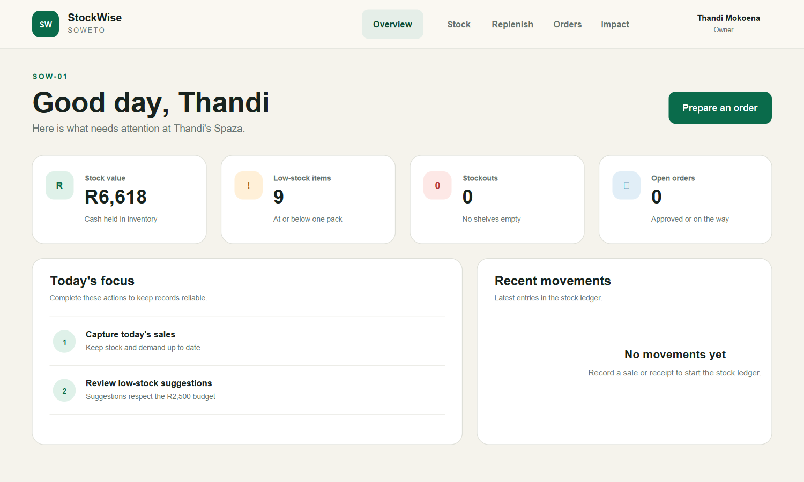
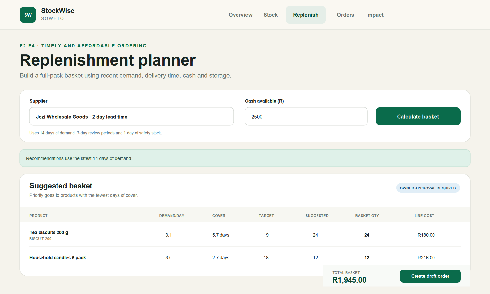

# StockWise Soweto - BFB 321 Group 8

StockWise Soweto is a web-based inventory and replenishment tool for independent spaza shops. It brings stock, recent sales and supplier information into one place. It then recommends full-pack order quantities that fit the shop's cash and storage limits. The owner reviews every basket before an order is approved.

This implementation develops the Group 8 BFB 321 proposal into a complete Flask and MySQL application. It focuses on 20 non-refrigerated SKUs and does not introduce customer credit, refrigerated products or a new delivery service.

## Group members

| Name | Student number |
|---|---|
| Andrew Holdt | u23565081 |
| Austin Ferraz | u23627132 |
| David de Villiers | u23570972 |
| David Plumb | u23526263 |

The public GitHub repository for submission should be named `BFB321_group_8`. Only the team representative should submit its full GitHub URL on behalf of the group.





## What is included

- Responsive and accessible HTML/CSS/JavaScript frontend
- Flask application factory, blueprints and session-based login
- REST API with validation, pagination, filtering and consistent errors
- MySQL 8 schema with foreign keys, checks, indexes and audit timestamps
- Standalone Python replenishment model with documented formulas
- Five seeded model shops, two suppliers and 20 realistic demo SKUs
- 34 unit, integration and page tests using `pytest`
- Docker and local run scripts, environment template, migrations and rollback
- ER diagram, architecture diagram and OpenAPI contract
- Repeatable 28-day impact simulation and usability test pack

## Main user flows

1. **Record stock:** the owner records a sale, receipt, loss, return or count adjustment. The stock ledger prevents a negative balance. Sales also update daily demand history.
2. **Prepare an order:** the owner chooses a supplier and cash budget. The model calculates target stock, days of cover and full-pack quantities. Urgent items receive priority when cash or storage is limited.
3. **Approve and receive:** the owner creates a draft, approves it after constraint checks, then receives the delivery. Receipt movements update the stock ledger automatically.

These flows cover proposal features F1-F5 and objectives O1-O4.

## Quick start (Windows, SQLite demo)

SQLite is provided only to make marking and demonstration easy. The production database design and Docker deployment use MySQL as required by the brief.

```powershell
cd soweto-spaza-replenishment
powershell -ExecutionPolicy Bypass -File .\scripts\start.ps1
```

Open <http://127.0.0.1:5000> and use:

- Owner: `owner@demo.co.za` / `demo2026`
- Administrator: `admin@demo.co.za` / `admin2026`

The first run creates `.venv`, installs packages and loads the demo data.

## MySQL run (recommended for assessment)

Install Docker Desktop, then run:

```powershell
docker compose up --build
```

Open <http://127.0.0.1:5000>. Docker starts MySQL 8, applies `database/schema.sql`, seeds the same five shops and runs the app with Gunicorn.

To stop the services without removing data:

```powershell
docker compose down
```

To start again, use `docker compose up`. The seed script is idempotent, so it does not duplicate demo data.

## Manual setup with an existing MySQL server

```powershell
python -m venv .venv
.\.venv\Scripts\Activate.ps1
python -m pip install -r requirements-dev.txt
mysql -u root -p -e "SOURCE database/schema.sql"
Copy-Item .env.example .env
python database\seed.py
python run.py
```

Change the credentials in `.env` before running the seed script. Do not commit `.env`.

## Replenishment model

For each SKU:

```text
Target stock S = d × (L + R + b)
Inventory position IP = stock on hand + confirmed stock on order
Recommended q = pack size × ceil(max(0, S - IP) / pack size)
Days of cover = IP / d
```

Where `d` is estimated daily demand, `L` is supplier lead time, `R` is the review period, and `b` is the safety-stock allowance in days. The service estimates `d` from the latest 14 days. When demand is missing, the result is marked provisional. `models/replenishment.py` contains no Flask or database imports, so it can be tested on its own.

The allocator sorts products by days of cover, reserves the supplier delivery fee, and adds one full pack at a time while enough cash and storage remain. It never creates partial packs.

## REST API summary

All endpoints require a signed-in session. Full request and response details are in [the OpenAPI contract](docs/openapi.yaml).

| Method | Endpoint | Purpose |
|---|---|---|
| `GET` | `/api/v1/inventory` | Paginated and filtered stock balances |
| `POST` | `/api/v1/movements` | Record a stock movement |
| `GET` | `/api/v1/recommendations` | Calculate a constrained supplier basket |
| `GET` | `/api/v1/orders` | Paginated orders with status filtering |
| `POST` | `/api/v1/orders` | Create a full-pack draft order |
| `POST` | `/api/v1/orders/{id}/approve` | Recheck cash and storage, then approve |
| `POST` | `/api/v1/orders/{id}/receive` | Receive outstanding lines and update stock |

Validation errors use a consistent JSON structure:

```json
{
  "error": "validation_error",
  "message": "Quantity must be a whole number greater than zero.",
  "fields": ["quantity"]
}
```

## Tests

```powershell
.\.venv\Scripts\python.exe -m pytest
```

The tests cover:

- proposal Appendix A calculations and pack rounding;
- cash and storage allocation priority;
- login protection, pagination and filtering;
- stock movement validation and negative-stock prevention;
- draft → approve → receive integration flow;
- full-pack order validation; and
- rendering of all main pages.

The final run passed all 34 tests with 98% coverage across the application and calculation model. The desktop, tablet and phone browser checks are recorded in [the QA report](docs/qa_report.md).

Run the repeatable impact evaluation with:

```powershell
.\.venv\Scripts\python.exe scripts\evaluate_impact.py
```

The script writes JSON and CSV evidence to `docs/generated/`. Its results are model outputs, not results collected from live spaza shops.

## Design and submission evidence

- [Architecture diagram](docs/architecture.svg)
- [ER diagram](docs/erd.svg)
- [System design and data dictionary](docs/system_design.md)
- [OpenAPI contract](docs/openapi.yaml)
- [Impact and sustainability analysis](docs/impact_and_sustainability.md)
- [Test plan and results](docs/test_plan_and_results.md)
- [Website quality assurance report](docs/qa_report.md)
- [Usability evaluation](docs/usability_test_results.md)
- [Maintenance and handover guide](docs/maintenance_guide.md)

## Deployment and operations

Production configuration uses `FLASK_ENV=production`, a long random `SECRET_KEY`, and a MySQL `DATABASE_URL`. Gunicorn starts two worker processes. Application logs rotate at 1 MB with three retained files. For a public deployment, put Nginx or another HTTPS reverse proxy in front of Gunicorn.

Database migration and rollback:

```powershell
mysql -u root -p -e "SOURCE database/migrations/0001_initial.sql"
mysql -u root -p -e "SOURCE database/migrations/0001_rollback.sql"
```

Create a backup on Linux:

```sh
MYSQL_HOST=localhost MYSQL_USER=spaza_user MYSQL_DATABASE=spaza_inventory ./scripts/backup_mysql.sh
```

Restore after creating an empty database:

```sh
mysql -h localhost -u spaza_user -p spaza_inventory < backups/spaza_YYYYMMDD_HHMMSS.sql
```

Test migration and restore steps on a non-production database first. Keep daily backups for 14 days. The project rollback script removes all application tables and must only be used with a confirmed backup.

## Scalability and privacy

- `shop_id` separates records, while ownership checks stop one owner from reading another shop.
- Composite indexes support common inventory, demand and order lookups.
- API pagination prevents large stock lists from being loaded at once.
- The schema can add users and shops without changing replenishment calculations.
- Shop codes may replace public-facing names. No customer personal information is collected.
- A larger deployment should add CSRF protection for JSON writes, HTTPS, managed backups, rate limiting and stronger administration controls.

## Academic note

The source and report text in this package were written specifically for this project. The team must still run the final files through the University's Turnitin process and confirm a similarity score of 15% or lower; no unverified Turnitin result is claimed here.

## References used from the proposal

- Cant & Associates (Pty) Ltd (2024), *Transforming the township retail market in South Africa: A sustainable growth and development model for spaza shops*.
- Coetzer, P. and Pascarel, N. (2014), ‘Last mile delivery in low income communities: The Sekulula Spaza Express experiment in South Africa’, *Field Actions Science Reports*, Special Issue 12.
- Deokaran, R. (2023), *The deployment of platform businesses in the township economy: A focus on spaza shops in Soweto*. University of the Witwatersrand.
- Eicker, T. and Cilliers, J.O. (2018), ‘Inventory decision-making by small Sowetan retailers’, *Journal of Transport and Supply Chain Management*, 12, a387.
- Hyndman, R.J. and Athanasopoulos, G. (2021), *Forecasting: Principles and Practice*, 3rd edition. OTexts.
