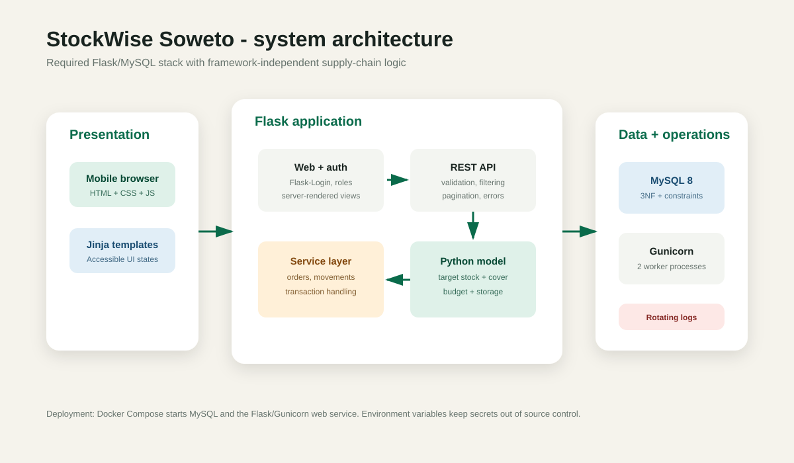
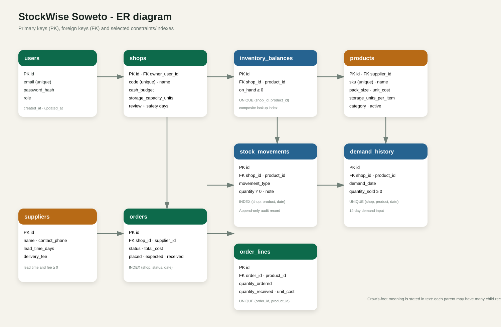

# System design and data dictionary

## Design decision

The system uses a simple three-layer structure. Jinja templates and JavaScript provide the user interface. Flask blueprints handle web pages, authentication and REST requests. Services connect the database to the standalone replenishment model. This separation keeps the calculation independent from routes and makes it easier to test.

## Main components

| Component | Responsibility |
|---|---|
| `app/blueprints/auth.py` | Login and logout using a secure password hash and session |
| `app/blueprints/web.py` | Owner-facing pages and KPI preparation |
| `app/blueprints/api.py` | JSON validation, role checks, filtering, pagination and transactions |
| `app/services/replenishment_service.py` | Converts database records into model inputs |
| `models/replenishment.py` | Formula and constraint allocation without Flask or SQLAlchemy |
| `app/models.py` | SQLAlchemy entities and relationships |
| `database/schema.sql` | MySQL keys, constraints and performance indexes |

## ER diagram

Each user may own many shops. Each shop has many balances, movements, demand records and orders. A product belongs to one supplier and can appear in many order lines. `inventory_balances` stores the current balance for fast display, while `stock_movements` gives the audit trail. The API updates both in the same database transaction.

## Normalisation

The model is in third normal form where practical:

- supplier details are stored once and referenced by products and orders;
- product pack size and cost are not repeated in inventory balances;
- order headers are separated from order lines;
- daily demand is stored by shop, product and date; and
- user details are separated from shops.

`order_lines.unit_cost` intentionally stores the purchase price at the time of an order. This is historical transaction data rather than duplication of the current product price.

## Data dictionary

| Table | Important fields | Purpose and rules |
|---|---|---|
| `users` | `email`, `password_hash`, `role` | Unique login identity. Role is `owner` or `admin`. |
| `shops` | `code`, `cash_budget`, `storage_capacity_units`, `review_period_days`, `safety_stock_days` | Settings and limits for one shop. |
| `suppliers` | `lead_time_days`, `delivery_fee` | Timing and fixed cost used by the replenishment model. |
| `products` | `sku`, `pack_size`, `unit_cost`, `storage_units_per_item`, `supplier_id` | One product/pack-size SKU. Pack and cost values cannot be negative. |
| `inventory_balances` | `shop_id`, `product_id`, `on_hand` | One current balance per shop/SKU. `on_hand` cannot be below zero. |
| `stock_movements` | `movement_type`, `quantity`, `note` | Signed audit entries. Sales/losses are negative; receipts/returns are positive. |
| `demand_history` | `demand_date`, `quantity_sold` | One daily quantity per shop/SKU. Used for the 14-day average. |
| `orders` | `status`, `delivery_fee`, `total_cost`, three event times | Supplier order lifecycle. Indexed by shop, status and date. |
| `order_lines` | `quantity_ordered`, `quantity_received`, `unit_cost` | Unique SKU within an order. Ordered quantity must be positive. |

Every table has `created_at` and `updated_at`. Composite indexes support `shop + product + date` lookups used by stock and demand functions.

## Access and error handling

Unauthenticated users are sent to the login page. Owners may only work with shops linked to their account. Administrator support is included for controlled oversight. API validation occurs before writes. Expected problems return clear 4xx JSON messages. Unexpected errors roll back the session and are written to a rotating log.

## Missing and provisional data

When no demand has been recorded in the last 14 days, the model returns zero demand and the API marks the recommendation set as provisional. The system does not pretend the estimate is reliable. A future field trial should decide whether to use a longer history or a manual starting estimate.

